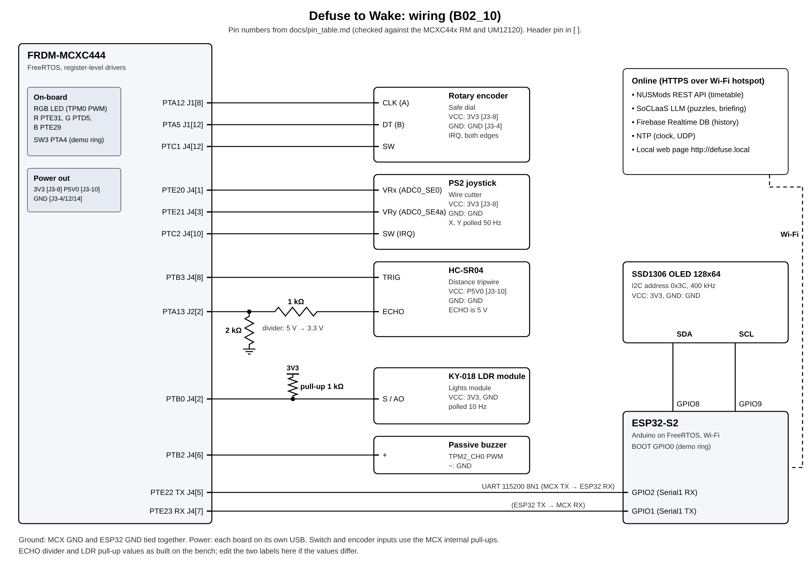

## Problem statement

Students sleep through morning lectures because a phone alarm is easy to silence half asleep. Defuse to Wake is a smart lecture alarm. It reads the user's NUSMods timetable and, at wake-up time (first class of the day minus a lead time), arms a "bomb" that ticks faster as time runs out and only stops when the user defuses it: enter a code on a rotary dial, cut the right wire with a joystick, hold a hand in a distance band in front of an ultrasonic sensor, and switch on a light. The code and the wire are answers to short brain-teasers written by an LLM, so the user also has to think. After the defuse the OLED shows a morning briefing and a coach message built from today's timetable and the user's recent history.

Our design rule is that the alarm never depends on the internet. The MCXC444 (FreeRTOS) is the game engine and owns every real-time sensor and actuator. The ESP32-S2 is the renderer (OLED) and the network gateway. Everything online is fetched ahead of time, cached in flash and has an offline fallback.

Feature list:

- Alarm for the first class of each day, at class start minus a lead time of 15 to 180 minutes (default 60), from a NUSMods share link.
- Four sensor modules in fixed order (dial, wires, tripwire, lights). Three strikes or a timeout explode the bomb and a new one starts 3 s later. Snooze with a long encoder press, at most twice, 5 minutes each.
- LLM brain-teasers for the dial and the wires, accepted only after the ESP32 has proved them by brute force and a second model has solved the text. Difficulty (Easy, Normal, Hard) comes from a score of the last 14 mornings, or is set by hand; it is deterministic, not the LLM.
- Buzzer, RGB LED and OLED feedback; morning history in flash with a write-only Firebase mirror; a local web page with fault injection; a framed UART protocol with CRC-8, ACK, retransmission and heartbeats.

## Sensors and Actuators used

| Sensor/Actuator | Description of use (data handling) | Libraries used (if any) |
|---|---|---|
| Rotary encoder with push (MCX) | Safe dial. Channels A and B (PTA12, PTA5) interrupt on both edges. The ISR decodes the Gray-code transition with a 16-entry table and emits one step per detent (2 valid transitions). The push (PTC1) interrupts on both edges: a press under 800 ms locks the digit, a longer one snoozes. | None; register-level code on the SDK's CMSIS device header |
| PS2 joystick with button (MCX) | Wire cutter. X (PTE20) and Y (PTE21) are read every 20 ms as 12-bit values. X becomes LEFT or RIGHT events with hysteresis (fires below 1000 or above 3000, re-arms between 1500 and 2600) and moves the wire cursor. The button (PTC2, interrupt) cuts the wire. | None (register level) |
| HC-SR04 ultrasonic (MCX) | Distance tripwire. A task pulses TRIG (PTB3) for 10 us every 60 ms. The echo (PTA13, TPM1_CH1) is timestamped on both edges at 1 us per count; cm = width / 58. A bad echo is 999. The game gets the median of the last 3 readings. | None (register level) |
| LDR module KY-018 (MCX) | Lights on. The analog output (PTB0, ADC0_SE8) is sampled at 10 Hz in the joystick task, averaged over 4 samples, shifted from 12 to 8 bits and inverted (APP_LDR_INVERT 1, the module reads high in the dark): level 0 (dark) to 255 (bright). | None (register level) |
| Passive buzzer (MCX) | TPM2_CH0 (PTB2) PWM at 50 % duty and the wanted frequency: a 2 kHz 30 ms tick, note patterns for digit accepted, strike (200 Hz), module cleared, defused jingle (523, 659, 784, 1047 Hz) and explosion. | None (register level) |
| RGB LED, on-board (MCX) | TPM0 PWM at 1 kHz (PTE31, PTD5, PTE29): dim blue armed, red blinking active, green defused, red and white alternating exploded, blue blink if the link is down while idle. | None (register level) |
| SSD1306 OLED 128x64, I2C 0x3C (ESP32) | Bomb screen at 10 frames per second: clock and next alarm, module graphics (dial digits, wires, tripwire gauge, light bar), the brain-teaser, hints after a strike, briefing and coach pages after a defuse. | Adafruit_SSD1306, Adafruit_GFX, Wire |

The ESP32 BOOT button and the MCX switch SW3 trigger a demo ring after 3 s. A GY-521 gyro was dropped (see Challenges), so the group has 4 sensors and 3 actuators.

## Hardware Architecture

The FRDM-MCXC444 holds the sensors, buzzer and LED; the ESP32-S2 holds the OLED and Wi-Fi. They are joined by one UART pair and a common ground, each on its own USB supply. The pin table stands in for the circuit diagram; each pin was checked against the reference manual (RM) and board manual, and "proven" pins come from our Lab 2 and 3 code.

| Signal | MCX pin | Function and mode | Note |
|---|---|---|---|
| UART2 TX, RX | PTE22, PTE23 | ALT4, interrupt driven | proven |
| RGB red, green, blue | PTE31, PTD5, PTE29 | TPM0_CH4, CH5, CH2 PWM | proven, active low |
| Joystick X, Y | PTE20, PTE21 | ADC0_SE0, ADC0_SE4a | proven, 3.3 V |
| Joystick button | PTC2 | GPIO, either-edge IRQ, pull-up | Port C has pin IRQs |
| Encoder A, B | PTA12, PTA5 | GPIO, either-edge IRQ, pull-up | Port A, one ISR |
| Encoder push | PTC1 | GPIO, either-edge IRQ, pull-up | long-press timing |
| SW3 (on-board) | PTA4 | GPIO, falling-edge IRQ | reset default is NMI |
| HC-SR04 TRIG, ECHO | PTB3, PTA13 | GPIO out, TPM1_CH1 capture | echo is 5 V |
| Passive buzzer | PTB2 | TPM2_CH0 PWM | TPM1 must free-run |
| LDR module AO | PTB0 | ADC0_SE8 | 3.3 V supply |

Ports B and E cannot raise pin interrupts on this chip (RM Table 11-1), so the encoder and buttons sit on Ports A and C. TPM0 drives the LED, TPM1 free-runs for the echo capture and TPM2 drives the buzzer (its modulus changes with every note, which would disturb a capture); all share an 8 MHz clock divided by 8, so one count is 1 us. On the ESP32-S2: Serial1 RX is GPIO2 (from PTE22) and TX is GPIO1 (to PTE23) at 115200 8N1; the OLED is on I2C SDA GPIO8 and SCL GPIO9 at 400 kHz; the BOOT button is GPIO0.

Wiring rules: the HC-SR04 echo is 5 V, so it goes through a resistor divider (our pin table proposes 1 kΩ in series and 2 kΩ to ground) [TODO: confirm the divider values used]. Joystick, encoder and LDR run from 3.3 V. The KY-018 needed an external 1 kΩ pull-up from its signal pin to 3.3 V (see Challenges), which is not yet in docs/pin_table.md.

Programming is register level (SIM, PORT, GPIO, UART, TPM, ADC, NVIC), as in the labs; the SDK is used only for board start-up and the debug console. The ADC is calibrated once before the scheduler starts, then runs 12-bit conversions with 4x hardware averaging. The encoder and buttons are interrupt driven because their edges are short and irregular. The joystick and LDR are analog with no interrupt of their own, so they are polled at a fixed period (the conversion ends with an interrupt, so the task sleeps instead of spinning). The ultrasonic sensor is a hybrid: a task triggers the ping periodically and hardware input capture timestamps the echo, so the result does not depend on task latency.

## Software Architecture

#### State Management (if applicable)

The game is a hardware-independent finite state machine (game/game.c, pure C99, no globals, no dynamic allocation, unit-tested on a PC). One MCX task owns it and feeds it events and a millisecond time; ISRs and other tasks only use queues.

| From | Trigger | To | Action |
|---|---|---|---|
| IDLE | SET_ALARM accepted (needs TIME_SYNC, alarm within 7 days) or RING_NOW | ARMED | store deadline, LED dim blue |
| ARMED | SET_ALARM or RING_NOW again | ARMED | move deadline |
| ARMED | tick finds time >= deadline | BOMB_ACTIVE | copy config, start timer |
| ARMED or BOMB_ACTIVE | CMD_CANCEL | IDLE | reset session |
| BOMB_ACTIVE | module cleared, more left | BOMB_ACTIVE | next module |
| BOMB_ACTIVE | last module cleared | DEFUSED | RESULT, jingle, LED green |
| BOMB_ACTIVE | 3 strikes, or timer 0 | EXPLODED | RESULT, explosion sound |
| BOMB_ACTIVE | long press or CMD_SNOOZE, under 2 snoozes | ARMED (snooze) | deadline +300 s, strikes reset |
| BOMB_ACTIVE | snooze with 2 used | BOMB_ACTIVE | denied sound |
| EXPLODED | 3 s | BOMB_ACTIVE | new bomb |
| DEFUSED | 30 s | IDLE | reset session |

A session runs from the first BOMB_ACTIVE until DEFUSED returns to IDLE, so snoozes and explosions are counted together. The engine adds an extra module per snooze or explosion up to four; as every bomb has four already, they are punished through the difficulty score instead. Module rules (game_config.h):

- Dial: the encoder changes the digit (0 to 9, wrapping), a press locks it; a wrong digit is a strike and resets the digit to 0.
- Wires: 3 to 6 wires; the joystick moves a clamped cursor, a press cuts; the wrong wire is a strike and stays cut.
- Tripwire: stay in a 10 cm band for 3000 ms. The ESP32 picks the band per bomb (lower edge 10 to 30 cm); leaving it for under 300 ms is forgiven. No strike.
- Lights: the first reading is the baseline and the target is min(max(baseline + 40, 120), 240); hold it for 2000 ms (300 ms grace). No strike. [TODO: update when the final torch-only threshold is fixed]

Every ESP32-sent config field is range-checked in the engine (module count 1 to 4, time limit 30 to 600 s, wires 3 to 6, strikes 1 to 5, tripwire bounds 5 to 100 cm with min below max, dial digits 0 to 9); a bad config is rejected and the previous one stays. On the ESP32 a session flag derived from GAME_STATE stops all SET_ALARM and CMD_CANCEL from the first BOMB_ACTIVE until the MCX is IDLE, so a snooze (which leaves the MCX ARMED) is never overwritten.

#### Task Structure

FreeRTOSConfig_Gen.h: preemption on (configUSE_PREEMPTION 1), time slicing on (configUSE_TIME_SLICING 1), 200 Hz tick (5 ms), 5 priorities, 12 KB heap, stack-overflow check method 2 and a malloc-failed hook that halts with the red LED on. Disabled: recursive mutexes, counting semaphores, queue sets, queue registry, thread-local storage, software timers (no timer task), trace facility, run-time stats, co-routines, tickless idle, idle and tick hooks. Every task, queue and mutex is created before the scheduler starts.

| MCX task | Prio | Stack (words) | Timing | Why this priority |
|---|---|---|---|---|
| game | 4 | 192 + size of game_t | blocks on input queue, tick every 50 ms | inputs and the deadline are handled at once |
| joystick | 3 | 128 | vTaskDelayUntil 20 ms; LDR every 5th loop | a fixed 50 Hz rate must not jitter |
| comm | 2 | 256 | blocks on RX queue, 10 ms timeout | link timers; the ISR buffers the bytes |
| ultrasonic | 2 | 128 | vTaskDelayUntil 60 ms | equal to comm on purpose: time slicing |
| feedback | 1 | 160 | vTaskDelayUntil 10 ms | tones and LED tolerate 10 ms |
| debug | 1 | 288 | notification | only when APP_DEBUG_STATS, APP_GAME_DEBUG or APP_DRIVER_TEST is set [TODO: confirm the flags of the submitted build] |
| idle | 0 | 90 | - | FreeRTOS idle |

| ESP32 task | Prio | Stack (bytes) | Timing | Role and priority reason |
|---|---|---|---|---|
| link | 4 | 6144 | 5 ms | owns proto_link and Serial1; no byte lost, 100 ms retransmit timer met; builds BOMB_CONFIG; never waits on network or flash |
| display | 2 | 6144 | 100 ms | OLED at 10 fps; a late frame is harmless |
| network | 1 | 12288 | 250 ms | Wi-Fi, NTP, NUSMods, SoCLaaS, Firebase, flash; blocks 10 to 30 s per call, so lowest |
| web | 1 | 8192 | 10 ms | WebServer and mDNS; a late page is harmless |
| gyro | 3 | 4096 | 20 ms | not created (APP_USE_GYRO 0) |

The ESP32-S2 has one core and no task pinning, so the priorities are the whole schedule. Blocking network work sits at the bottom, and urgent work was moved out of it: BOMB_CONFIG building and the demo ring run in the link task.

ISRs use only FromISR calls and portYIELD_FROM_ISR, with no printf, delay or waiting loop. The Cortex-M0+ NVIC has 2 priority bits (64 is more urgent than 128), and its FreeRTOS port masks with PRIMASK, so FromISR calls are legal at any level. The UART and echo capture are above the GPIO and ADC interrupts: the UART receive register holds one byte, and the rising echo edge must be handled before the falling one.

| ISR | NVIC | Trigger | What it does |
|---|---|---|---|
| UART2_FLEXIO | 64 | RX full, TX empty | RX: read byte, count errors, xQueueSendFromISR. TX: feed the next ring byte, stop when empty |
| TPM1 | 64 | echo capture, overflow | read timestamp, classify edge by pin level, compute width, notify ultrasonic task |
| ADC0 | 128 | conversion done | read result, notify joystick task |
| PORTA | 128 | encoder A/B, SW3 | decode quadrature, post ENC_STEP or RING_NOW |
| PORTC_PORTD | 128 | encoder push, joystick push | debounce 30 ms, short or long press, post ENC_PRESS, ENC_LONG_PRESS, JOY_PRESS |

#### Coordination & Synchronisation

The MCX is event driven. Every input (encoder, buttons, joystick, ultrasonic, LDR, ESP32 commands) becomes a game event in one input queue, so the game task has a single blocking point: a queue receive whose timeout is the next 50 ms tick. The ADC and echo-capture ISRs wake their tasks with task notifications. Flow: sensor ISR or task, input queue, game task, snapshot, comm task, GAME_STATE frame; and ESP32 frame, comm task, control or input queue, game task.

| Object | Type and size | Producer to consumer | Purpose |
|---|---|---|---|
| RX queue | queue, 128 bytes | UART ISR to comm | received bytes (about 11 ms of line time) |
| TX request queue | queue, 4 frames | game to comm | RESULT frames to send |
| Input queue | queue, 16 events | ISRs, joystick, ultrasonic, comm to game | all game events |
| Control queue | queue, 4 | comm to game | TIME_SYNC, SET_ALARM, BOMB_CONFIG |
| Feedback queue | queue, 8 | game, comm to feedback | sounds, tick period, LED mode, link state |
| TX ring | 256 bytes, no OS object | comm to UART ISR | outgoing bytes, about 6 maximum frames |
| Snapshot mutex | mutex, 5 ms wait | game writes; comm, debug read | the state copy sent as GAME_STATE |

Every send uses a zero timeout and counts a drop instead of blocking, so no producer can stall another task. On the ESP32 the shared objects are the app-state struct (mutex, 10 ms wait; written by the link task, read by display, network and web), a TX queue of 8 frames (other tasks to the link task) and a result queue of 8 (link to network task, so the link task never writes flash).

#### Resource Protection

- game_t is touched only by the game task, and proto_link_t (with its retransmit state) only by the comm task. This single-owner rule needs no lock.
- ADC0 is shared by the joystick and the LDR, so one owner task samples both (the LDR after the joystick) and two conversions can never overlap. TPM0 and TPM2 belong to the feedback task, TPM1 to the ultrasonic task and its ISR.
- The state snapshot is a multi-word struct copied by three tasks. It uses a mutex, not a critical section, because a critical section would mask the UART interrupt for the whole copy. FreeRTOS mutexes have priority inheritance: if the priority 1 debug task holds it and priority 2 comm preempts it, the priority 4 game task waiting for it lends its priority, which avoids priority inversion. Every take has a bounded wait and a timeout is counted.
- The TX ring is written by the comm task and read by the UART ISR. The task copies one whole frame (at most 37 bytes) in a short critical section; a frame that does not fit is dropped whole and retransmission recovers it.
- ESP32: bounded-wait mutexes guard the app state (10 ms), I2C bus (30 ms), flash store, timetable, history ring, puzzle set and BOMB_CONFIG state (20 ms). Short critical sections guard single flags and the frame log.

## Communication Protocol

#### UART Configuration

UART2 on the MCX (TX PTE22, RX PTE23, ALT4) is crossed to Serial1 on the ESP32-S2 (RX GPIO2, TX GPIO1): 115200 baud, 8 data bits, no parity, 1 stop bit, 3.3 V, common ground. The MCX uses interrupts for both directions (RX into a 128-byte queue, TX from a 256-byte ring); the ESP32 link task polls Serial1 every 5 ms.

#### Packet description

Frame (shared/protocol.c, compiled unchanged on both boards): `[0xAA][TYPE][SEQ][LEN][PAYLOAD 0 to 32][CRC-8]`, at most 37 bytes. CRC-8 uses polynomial 0x07, initial value 0, no reflection and no final XOR, over TYPE, SEQ, LEN and PAYLOAD (CRC("123456789") = 0xF4). Fields are little-endian and packed byte by byte.

| Type | Value | Direction | Payload | Bytes | Class |
|---|---|---|---|---|---|
| HEARTBEAT | 0x01 | both | uptime_s | 4 | unreliable |
| ACK | 0x02 | both | acked_seq | 1 | unreliable |
| NACK | 0x03 | both | acked_seq, reason (1 CRC, 2 length, 3 unknown type) | 2 | unreliable |
| TIME_SYNC | 0x10 | ESP32 to MCX | unix_time | 4 | reliable |
| SET_ALARM | 0x11 | ESP32 to MCX | alarm_unix | 4 | reliable |
| BOMB_CONFIG | 0x12 | ESP32 to MCX | module count and order, time limit, dial code, wire count, correct wire, tripwire min and max, max strikes | 16 | reliable |
| TAMPER_EVENT | 0x13 | ESP32 to MCX | magnitude_mg (unused, gyro off) | 2 | reliable |
| CMD | 0x14 | ESP32 to MCX | cmd (1 RING_NOW, 2 SNOOZE, 3 CANCEL), arg | 3 | reliable |
| GAME_STATE | 0x20 | MCX to ESP32 | state, module index and type, time left, strikes, progress %, module value | 9 | unreliable |
| RESULT | 0x21 | MCX to ESP32 | outcome, duration, strikes, snoozes | 5 | reliable |
| TELEMETRY | 0x22 | MCX to ESP32 | joystick X and Y, distance, encoder count | 8 | unreliable |

Reliable frames use stop-and-wait (shared/proto_link.c, 148 host checks): one frame is outstanding, more wait in a FIFO of 4, and when it is full the send call fails, so the ESP32 keeps the frame in its TX queue (back pressure). The sender retransmits the same SEQ after 100 ms without ACK or at once after a NACK, and gives up after 3 retransmissions with a SEND_FAILED event. The receiver ACKs every valid reliable frame and delivers it once; a repeated SEQ (lost ACK) is re-ACKed only. A CRC error gives NACK(0xFF, 1), a length error NACK(0xFF, 2), an unknown type NACK(seq, 3). The decoder resynchronises on the next 0xAA and replays buffered bytes. Heartbeats go every second and the link is down after 3 s of silence. Unreliable frames are rate limited at the source: GAME_STATE only when changed and at most every 100 ms, TELEMETRY every 500 ms. The ESP32 always sends TIME_SYNC, then BOMB_CONFIG, then SET_ALARM, and repeats SET_ALARM after every TIME_SYNC, because the MCX does not move an armed deadline when its clock changes. The engineering web page shows the last 20 frames with type, SEQ and outcome, and a button corrupts the CRC of the next reliable frame to show the NACK and retransmission live. [TODO: add measured retransmit and NACK counts from a bench run]

## Online Function Used

All online calls run in the lowest-priority network task over HTTPS, with the server certificate checked against the ESP32 core's CA bundle and a 10 s timeout (30 s for the LLM). None is needed at alarm time.

| Service | ESP32 sends | ESP32 receives | Offline fallback |
|---|---|---|---|
| NUSMods REST | GET api.nusmods.com/v2/2026-2027/modules/CODE.json for each module code in the share link | about 5 KB JSON per module; a filter keeps semester 1 lessons (class, day, start, end, weeks, type, venue) | timetable cache in flash (40 lessons); a failed refresh keeps it and retries after 5 min |
| SoCLaaS LLM | POST /v1/chat/completions: model ID, system and user message, max_tokens 2000, temperature, API key in the Authorization header (kept in a git-ignored file) | choices[0].message.content and finish_reason | local procedural puzzle bank; template briefing |
| Firebase Realtime Database | POST one JSON record per defused morning: time stamp, duration, strikes, snoozes, explosions, module, device id | HTTP status only; never read back | flash queue of 14 records, retry back-off 60 s to 10 min |
| NTP | SNTP to pool.ntp.org and time.google.com | Unix time (UTC+8 added in code) | none: needs Wi-Fi once after power-up; the MCX keeps an armed alarm across ESP32 resets |

NUSMods turns the share link into the alarm. A refresh runs at boot, each evening after 22:00, when settings change, and 5 minutes after a failure. The scheduler (209 host checks) takes the first class of the next day that has one, honouring week numbers, the recess week and the semester end, and sets the alarm to class start minus the lead time.

The LLM writes the puzzles and the morning message. The ESP32 picks each answer itself (a random 4-digit code or a wire number) and the level, and tells the setter model the answer. The setter must return JSON with a riddle (at most 63 characters for the dial, 42 for wires, so it fits the OLED) and a rule set in a small rule language. The ESP32 then rejects riddles that spell out the code, parses the rules, brute-forces all 10,000 codes (or all wires) to prove there is exactly one solution equal to our answer, and rates the difficulty with its own solver, so the level is computed, not taken from the LLM. Finally only the riddle text (no rules, no answer) goes to a checker model with a different model ID, which must reach the same answer. After 3 failed attempts a procedural bank builds a proven puzzle at the same level. A run makes 4 dial and 4 wire puzzles (at boot if no set is under 24 h old, every evening at 22:00, or on request), at most one LLM call per loop pass, and never in a bomb session or within 5 minutes of the alarm. The setter chain is qwen3.6:35b, x-test-1, x-test-2, default; the checker chain starts at x-test-1. The briefing call sends the alarm time, up to 6 classes, a summary of recent mornings and the difficulty, and returns a briefing (up to 120 characters) and a coach message (up to 80); bad replies become templates. The qwen3.6:35b setter answered in about 3 s in our board tests. [TODO: add measured latencies and the share of AI-verified puzzles]

## Additional Features

- Local web page, served by the ESP32 in its own task at http://defuse.local (mDNS) or the IP on the OLED. The main page (next alarm, NUSMods link, lead-time slider, difficulty mode, Save, Ring now) polls every 2 s. The engineering page /eng (polled every 500 ms) shows the briefing, live bomb, link statistics, frame log, AI panel (setter model, checker answer, verified or rejected) and Firebase queue, with two fault buttons: "Corrupt next packet" and "Simulate internet outage" (60 s, HTTPS calls fail but Wi-Fi stays up).
- Deterministic difficulty: a score starts at 50 and is replayed over the stored mornings (+8 for a fast clean defuse of 90 s or less, -10 per explosion, -5 per snooze, clamped to 0 to 100). 0 to 33 is Easy (240 s, 3 or 4 wires), 34 to 66 Normal (180 s, 4 or 5 wires), 67 to 100 Hard (150 s, 6 wires); the user can force a level.
- Host tests: 15 test programs, all passing when run on 28 Oct 2026, including the codec (91 checks), link layer (148), game engine (353), scheduler (209), rule language (6237) and procedural bank (39573). Bench-test procedures for both boards are in docs/hw_test_*.md. [TODO: end-to-end hardware test results of the full four-module bomb on both boards]

## Challenges faced & Solutions

- **Gyro shorted the I2C bus.** The GY-521 gyro shared the I2C bus with the OLED, and its board shorted the bus and stopped the OLED. After several days on an I2C scan, an address fallback and a register-level driver for clone chips, we dropped it on 27 Oct (rule: no new I2C devices) and replaced tamper detection with the LDR "lights on" module. The gyro code stays behind APP_USE_GYRO 0.
- **LDR module stuck at 0 or 255.** The on-board resistor of our KY-018 module was open, so its level did not move until we added an external 1 kΩ pull-up from the signal pin to 3.3 V [TODO: confirm the resistor value on the bench]. Its polarity was also reversed (high in the dark), so we added APP_LDR_INVERT.
- **One ADC for two sensors.** Joystick and LDR both need ADC0. The joystick task owns the ADC and samples the LDR every fifth loop, and the conversion-complete interrupt wakes it through a notification.
- **Empty LLM replies.** On 21 Oct x-test-2 (DeepSeek) returned empty replies on the board, and thinking models spent a 600-token budget before answering. We raised max_tokens to 2000, log finish_reason, use different models for setter (qwen3.6:35b) and checker (x-test-1) with the others as fallbacks, and keep a local bank behind them. The interim report had the roles the other way round.
- **Wrong or leaking puzzles.** An LLM can write a riddle with no answer, several answers, a wrong answer or the code spelled out. The LLM now returns rules that the ESP32 proves unique by brute force and rates itself, answer leaks are rejected, and a checker from another model must solve the text alone. The bank uses the same proof.
- **Never overwriting an armed alarm.** After a snooze the MCX stays ARMED, and a re-sent SET_ALARM or a CANCEL would overwrite or kill it. The ESP32 now tracks a session and sends nothing during it, and always sends TIME_SYNC before SET_ALARM.
- **Slow network calls on the alarm path.** A 30 s LLM call delayed a button press and could miss the 3 s window between an explosion and the next bomb. BOMB_CONFIG building and the demo ring moved to the priority 4 link task, which only touches RAM; flash writes stay in the network task behind a queue.
- **Noisy tripwire.** One lost or stray echo reset the 3 s hold. The capture rule re-arms at every ping and rejects edges in the wrong order, the game uses a median of 3 readings, and a 300 ms grace period delays the reset.
- **ESP32 memory and parsing.** Streaming the NUSMods JSON stalled partway, so the body is read fully and parsed through a filter. TLS and LLM buffers need contiguous RAM, so large buffers are allocated once from PSRAM.

## Conclusion

Defuse to Wake meets the brief with four sensors and three actuators over two boards. The MCXC444 runs a preemptive FreeRTOS design with five interrupt handlers, one event queue and one game task, where each peripheral and each state structure has one owner. The ESP32-S2 adds timetable-driven alarms, proven LLM puzzles, a briefing, a web page and a write-only cloud mirror, and the game keeps working when any of them fails. The CRC, ACK and retransmission protocol is one shared source file on both boards and is covered by host tests.

Next steps: finish calibrating the light threshold, record retransmit and latency figures, and run the full four-module bomb repeatedly on both boards [TODO: end-to-end test results]. A battery-backed RTC would remove the need for Wi-Fi once after power-up. The online monitor page (stretch goal) is not implemented.
